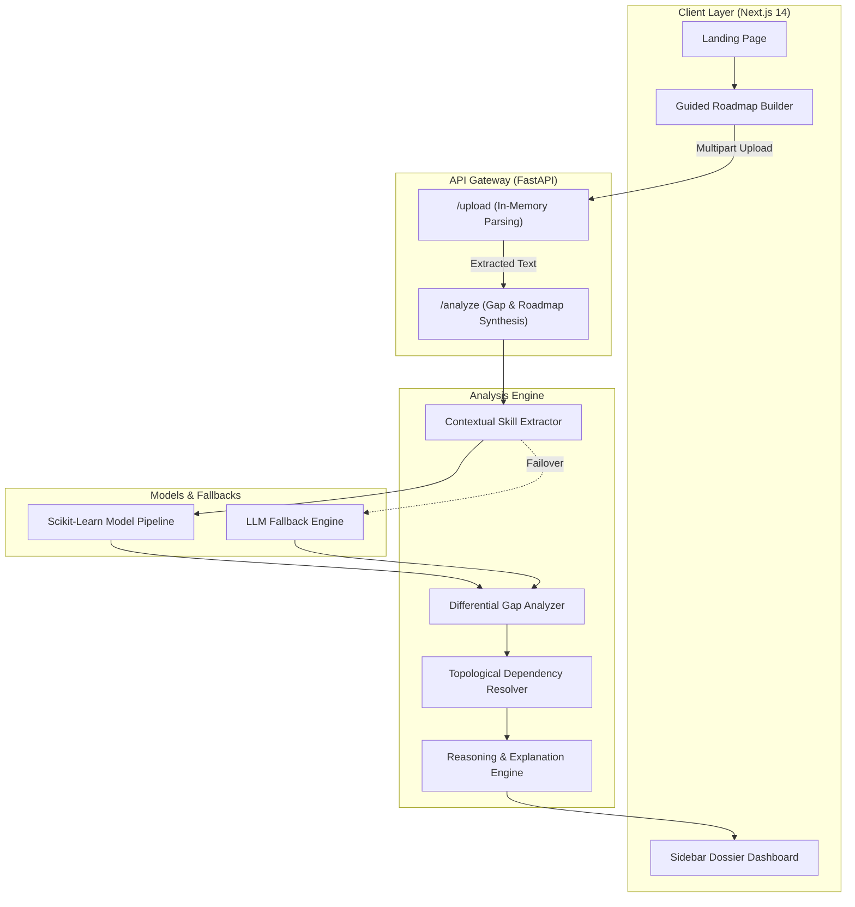

# Intra.ai

### Personalized AI Career Roadmap and Skill Gap Analyzer

Intra.ai is an intelligent career acceleration platform that evaluates candidate resumes against real industry job requirements, identifies critical screening gaps, and generates a personalized, step-by-step learning roadmap.

---

## Overview

Traditional online courses and learning management systems rely on rigid, 200+ hour generic catalogs. They frequently re-teach skills candidates already command, miss the exact screening criteria hiring managers filter for, and present topics without prerequisite awareness.

Intra.ai addresses this with a deterministic, gap-focused approach:
- Evaluates practical project deliverables and technical toolchains directly from resumes.
- Benchmarks existing skills against target job specifications to isolate screening dealbreakers.
- Uses Directed Acyclic Graph (DAG) dependency sequencing to order prerequisite topics logically.
- Skips verified competencies automatically, reducing preparation time by up to 45%.
- Operates entirely in memory, ensuring user resumes and job descriptions are never saved or sold.

---

## Core Capabilities

- **Contextual Skill Extraction**: Identifies technical proficiencies and depth from real project work rather than simple keyword matching.
- **Differential Gap Analysis**: Distinguishes mandatory first-round screening dealbreakers from secondary or optional competencies.
- **Topological Roadmap Sequencing**: Structures learning milestones logically by resolving prerequisite dependencies before advanced topics.
- **Explainable Reasoning (XAI)**: Provides transparent rationale traces explaining why specific modules are prioritized or skipped.
- **Single-Focus Guided Workflow**: A focused 3-step setup (Resume Upload, Target Role Selection, Review and Generation) that keeps the interface intuitive and clutter-free.
- **Dedicated Application Dashboard**: A professional left-sidebar workspace organizing learning milestones, gap diagnostics, competency radar charts, and decision traces.
- **In-Memory Privacy**: Documents are parsed in runtime memory during the session and are never written to disk or used for external model training.

---

## System Architecture



---

## Repository Structure

```
Intra-AI/
├── backend/
│   ├── app/
│   │   ├── main.py                     # FastAPI application entry point and CORS configuration
│   │   ├── routes/
│   │   │   ├── analysis.py             # /analyze endpoint orchestration
│   │   │   ├── roadmap.py              # Dynamic DAG roadmap generation
│   │   │   ├── training.py             # Model training and fine-tuning endpoints
│   │   │   ├── upload.py               # In-memory PDF, DOCX, and TXT document parser
│   │   │   └── upload_fallback.py      # Resilient upload fallback handler
│   │   ├── services/
│   │   │   ├── ai_engine.py            # Primary AI extraction engine
│   │   │   ├── custom_model.py         # Local ML model evaluation
│   │   │   ├── dependency_resolver.py  # Topological DAG prerequisite graph
│   │   │   ├── gap_analyzer.py         # Differential competency delta calculator
│   │   │   ├── reasoning_engine.py     # Explainable AI (XAI) audit traces
│   │   │   └── resume_parser.py        # Structural text and token extraction
│   │   └── utils/
│   │       ├── course_catalog.json     # Curated practical deliverables catalog
│   │       └── skill_map.json          # Prerequisite dependency map
│   ├── Dockerfile                      # Production container specification
│   └── requirements.txt                # Python backend dependencies
│
├── frontend/
│   ├── components/
│   │   ├── BrandLogo.js                # Minimalist geometric brand mark
│   │   ├── CinematicHero.js            # Clear, benefit-driven hero section
│   │   ├── SimpleHowItWorks.js         # Three-step methodology breakdown
│   │   ├── InteractivePreview.js       # Interactive role preview explorer
│   │   ├── FeaturesGridSection.js      # Core architectural capabilities grid
│   │   ├── ComparisonSection.js        # Traditional LMS vs. Intra.ai comparison matrix
│   │   ├── ClosingJourneySection.js    # Bottom call to action and footer
│   │   ├── WorkspaceApp.js             # Three-step guided roadmap builder
│   │   ├── ResultsDashboard.js         # Left-sidebar results dossier and milestone tracker
│   │   ├── SkillRadar.js               # Multi-axial Recharts radar chart
│   │   └── ThemeProvider.js            # Design system context
│   ├── pages/
│   │   ├── _app.js                     # Global styling wrapper
│   │   ├── _document.js                # HTML head and typography configuration
│   │   └── index.js                    # Root view controller (Landing, Workspace, Results)
│   ├── public/
│   │   └── assets/                     # Graphic assets
│   ├── styles/
│   │   └── globals.css                 # Global CSS and Tailwind directives
│   ├── tailwind.config.js              # TailwindCSS configuration
│   └── package.json                    # Frontend dependencies
│
└── README.md
```

---

## Local Development Setup

### System Requirements
- Python 3.9 or higher
- Node.js 18.x or 20.x
- npm or yarn

---

### 1. Backend Service (FastAPI)

1. Navigate to the backend directory:
   ```bash
   cd backend
   ```

2. Create and activate a virtual environment:
   - On Windows (PowerShell):
     ```powershell
     python -m venv venv
     .\venv\Scripts\Activate.ps1
     ```
   - On macOS or Linux:
     ```bash
     python3 -m venv venv
     source venv/bin/activate
     ```

3. Install required Python packages:
   ```bash
   pip install -r requirements.txt
   ```

4. Optional configuration:
   Create a `.env` file in `backend/` if you wish to configure an `OPENAI_API_KEY`. If omitted, the platform automatically utilizes its local model and dataset fallbacks.

5. Start the backend development server:
   ```bash
   python -m uvicorn app.main:app --host 0.0.0.0 --port 8000 --reload
   ```

   The backend service will be available at `http://localhost:8000`.  
   Interactive API documentation (Swagger UI) is available at `http://localhost:8000/docs`.

---

### 2. Frontend Application (Next.js)

Open a separate terminal window:

1. Navigate to the frontend directory:
   ```bash
   cd frontend
   ```

2. Install dependencies:
   ```bash
   npm install
   ```

3. Start the Next.js development server:
   ```bash
   npm run dev
   ```

4. Open `http://localhost:3000` in your browser.

---

## API Reference

### POST /upload
Parses resume and job description documents in memory and extracts text.

- **Content-Type**: `multipart/form-data`
- **Request Body**:
  - `resume`: Binary file (`.pdf`, `.docx`, `.txt`)
  - `jd`: Binary file or pre-calibrated text (`.pdf`, `.docx`, `.txt`)
- **Response**:
  ```json
  {
    "resume": "Extracted resume text content...",
    "jd": "Extracted job description text content..."
  }
  ```

### POST /analyze
Executes competency profiling, gap diagnosis, and prerequisite roadmap sequencing.

- **Content-Type**: `application/json`
- **Request Body**:
  ```json
  {
    "resume": "Candidate resume text...",
    "jd": "Target job description text..."
  }
  ```
- **Response Structure**:
  ```json
  {
    "overall_score": 82.5,
    "analysis": {
      "job_readiness_label": "Competitive Candidate",
      "missing_skills": ["Docker", "Kubernetes"],
      "weak_skills": ["GraphQL"]
    },
    "skill_dna": {
      "Python": { "conceptual": 95, "practical": 90, "real_world": 85 }
    },
    "gap": [
      { "skill": "Kubernetes", "status": "missing", "priority": "High" }
    ],
    "roadmap": [
      {
        "skill": "Docker Containerization",
        "level": "Prerequisite",
        "course": {
          "title": "Container Orchestration Essentials",
          "duration": "1 Week",
          "task": "Containerize a multi-service FastAPI application with health checks."
        }
      }
    ],
    "time_saved": 40,
    "reasoning": [
      {
        "skill": "Docker",
        "priority": "High",
        "reason": "Required foundational prerequisite for Kubernetes deployment.",
        "action": "Complete container packaging project."
      }
    ]
  }
  ```

---

## Docker Deployment

To build and run the backend inside a container:

```bash
cd backend
docker build -t intra-ai-engine .
docker run -p 8000:8000 intra-ai-engine
```

---

## Performance Comparison

| Metric | Traditional Courses / Generic LMS | Intra.ai Adaptive Engine |
| :--- | :--- | :--- |
| **Time to Job Readiness** | 6 to 9 Months | **2.5 to 4 Months (~45% time saved)** |
| **Skill Profiling Depth** | Surface keyword counts | **Multi-tier contextual project evaluation** |
| **Redundant Training** | Forces study of mastered basics | **Zero redundant study (automatically skipped)** |
| **Sequencing Method** | Linear playlist | **Directed Acyclic Graph (prerequisites first)** |
| **Data Retention** | Stored on persistent databases | **100% in-memory runtime processing** |

---

## License

This project is licensed under the MIT License. See the [LICENSE](LICENSE) file for details.
